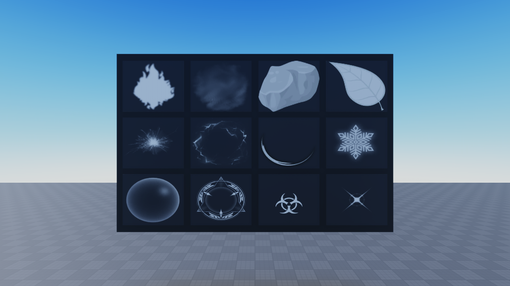
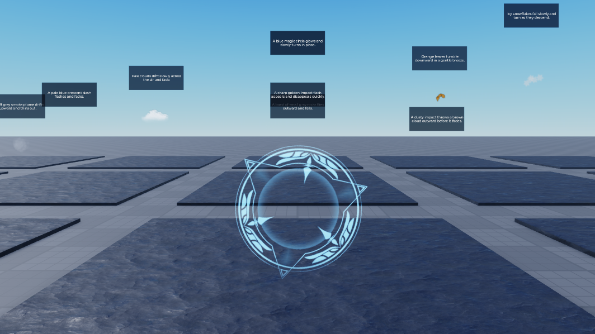

# CIX texture review

The catalog in [cix_catalog.json](../data/cix_catalog.json) was read from CIX Library V5.1 in Studio. It has 409 static cards and 213 flipbook cards. Those 622 cards point to 610 distinct image IDs; some cards repeat an ID or name. The catalog records what CIX displays, not a claim that every image is useful for a single-emitter effect.

The review board renders each image ID as a Roblox decal. This checks the actual image on a dark or light background. Flipbook cards show their complete sprite sheet on the board; the emitter preview is needed to check the grid layout and animation. The Studio module is [cix_review.lua](../roblox/cix_review.lua).



From Studio's Command Bar:

```lua
local review = require(game.ServerStorage.Prompt2Particles.CIXReview)
review.showPage("Particle", 1)             -- 35 pages
review.showPage("FlipBook", 1, true)        -- 18 pages, light background
review.showNames("Particle", {"Fire1", "Smoke3", "Snowflake3"})
```

The review board lives in `Workspace.CIXTextureReview`, outside the dataset. Each tile is named with its page index and CIX card name, and has the image ID as an attribute. Calling `showPage` replaces only that board and moves the Studio camera to it.

## First emitter batch

[cix_pilot.lua](../roblox/cix_pilot.lua) built 30 effects in the place: 20 static textures and 10 flipbooks. They are under their effect families directly in `Workspace.Particles.Dataset`, named `N018` through `N047`. Each has one `ParticleEmitter`, an `EmitCount` attribute, a prompt billboard, and a review floor. Their individual texture IDs, prompts, and visual notes are in [cix_pilot_review.json](../data/cix_pilot_review.json).

The 30 pilot attachments are now in `train`. The first batch adds 29 texture IDs not present in the earlier export; one ID was already used.



To rebuild missing pilot effects or focus one:

```lua
local pilot = require(game.ServerStorage.Prompt2Particles.CIXPilot)
pilot.build()           -- skips effects that already exist
pilot.focus("N033")     -- moves the camera; replays a burst when needed
```

The effects were checked in Studio against their prompts. Several initial choices were changed after viewing them: the snow puff became a visible snowflake, lightning arcs and stars were enlarged, the animated slash and shockwave received different sheets, and debris uses a random starting frame to keep its shard shape. Prompts were rewritten wherever they claimed a cloud, camera-facing action, surface, or other detail the emitter did not actually show.

The local [cix_pilot_roundtrip.lua](../roblox/tests/cix_pilot_roundtrip.lua) is also installed as `ServerStorage.Prompt2Particles.CIXPilotRoundtrip`. In Studio:

```lua
require(game.ServerStorage.Prompt2Particles.CIXPilotRoundtrip)()
```

The latest run recreated all 30 emitters with 960 particle-property comparisons, zero exporter warnings, and zero mismatches. It also compared `EmitCount` and prompt text.

## Raised CIX set

The remaining 574 distinct image IDs now have one emitter each, `N048` through `N621`. Their source cards, textures, families, prompts, colors, flipbook layouts, and split labels are in [cix_expansion_manifest.json](../data/cix_expansion_manifest.json). [build_cix_expansion.py](../scripts/build_cix_expansion.py) generates the manifest and [cix_expansion.lua](../roblox/cix_expansion.lua); the latter is installed as `ServerStorage.Prompt2Particles.CIXExpansion`. The template for the builder is [cix_expansion.template.lua](../roblox/cix_expansion.template.lua).

All 604 CIX effects, including the pilot, sit on raised floors centered at Y = 80, above the earlier dataset. The new floors are spaced 40 studs apart; close to an emitter, only its own prompt billboard is visible. The new effects peak at 7 studs or less, near the earlier dataset's 5-stud median and 7.5-stud upper quartile. Small snow, sparks, leaves, and debris use smaller sizes. Each new attachment has one `ParticleEmitter`, `Category`, a `Split` label, and a prompt. Its emitter has `EmitCount` (318 bursts and 256 continuous effects in the expansion).

The 18 flipbook gallery pages were checked for frame grids. The manifest records 2×2 or 8×8 exceptions; the other flipbooks use 4×4. Studio previews led to smaller letter glyphs, separate dark fire and soot recipes, clearer sparkle streaks, a snow-puff label for the blurry `Snowflake1` image, and a cosmic accretion-ring label for `BlackHole1`. The user approved the visuals; a few source images still have limited detail as single-emitter particles.

To focus an effect and emit its burst in Studio:

```lua
require(game.ServerStorage.Prompt2Particles.CIXExpansion).focus("N376")
```

To rebuild missing members in batches:

```lua
local expansion = require(game.ServerStorage.Prompt2Particles.CIXExpansion)
expansion.build(1, 40)
expansion.build(41, 80)
```

[cix_expansion_roundtrip.lua](../roblox/tests/cix_expansion_roundtrip.lua) is installed as `ServerStorage.Prompt2Particles.CIXExpansionRoundtrip`. Run:

```lua
require(game.ServerStorage.Prompt2Particles.CIXExpansionRoundtrip)()
```

The latest full run checked 574 effects and 18,368 emitter properties, with zero exporter warnings and zero mismatches. It also compared `EmitCount`, prompt text, `Category`, and `Split`. The pilot roundtrip still passes after moving its floors. `python scripts/cix_coverage.py` reports all 610 distinct CIX image IDs covered by the export and Studio; none are unused.

## Training split

Before prompt review, the 604 CIX effects had only 199 distinct main prompts. If every effect were trained with that wording, a text-only model could make at most 199 correct texture choices on those 604 rows. A first training run with all 604 confirmed the limit: 198 texture hits on its own CIX training rows (32.8%), with held-out texture accuracy almost unchanged from the earlier model.

The initial retained training split contained all 30 pilot effects and one expansion effect per distinct wording (169 expansion effects). The other 405 expansion effects stayed in `review` with their emitters and visuals intact. After a visual review of 60 effects, 15 were reserved for a separate CIX texture check. The current Studio counts are 1,231 train, 212 validation, 211 test, 260 generalization, and 371 review. The 987 earlier train rows and all evaluation rows are unchanged.

## Model check

The full model was retrained on all 604 new effects, on the initial 199 retained effects, and on 259 CIX effects before 15 were reserved. None improved held-out texture and burst prediction enough to replace the earlier model. The active local checkpoint keeps that earlier model's numeric, curve, and burst predictions and uses the current 1,231-row training set for its uncertain-texture lookup. `scripts/prepare_cix_checkpoint.py` creates this checkpoint without changing the recorded fingerprint of the data used to fit the model.

| Method | Test texture (211) | Held-out base texture (260) | Test burst | Held-out burst | Held-out color MAE |
| --- | ---: | ---: | ---: | ---: | ---: |
| Earlier full model, raw | 83.9% | 27.3% | 100.0% | 92.3% | 0.158 |
| Retrained on all 604, raw | 83.4% | 27.3% | 100.0% | 92.7% | 0.166 |
| Retrained on 199, raw | 83.4% | 27.7% | 100.0% | 88.5% | 0.162 |
| Retrained on 259, raw | 86.3% | 27.3% | 100.0% | 88.5% | 0.162 |
| Active model with updated texture lookup | 82.9% | 33.8% | 100.0% | 92.3% | 0.158 |

The lookup uses a MiniLM nearest neighbor only when the model's texture confidence is below 0.6926. Its result is measured separately from the raw model. It makes the new CIX textures available to the plugin, but the held-out texture score is not an improvement over the earlier model's previous lookup. Scores and per-effect errors are in the ignored local `checkpoints/cix_hybrid_evaluation.json` and matching `*_errors_*.jsonl` files. To reproduce the active configuration after generating the training export:

```sh
python scripts/prepare_cix_checkpoint.py
python scripts/evaluate_full.py --neighbor-texture-threshold 0.6926 --output checkpoints/cix_hybrid_evaluation.json
```

The first 60 reviewed prompts, the 20-base development benchmark, and visual comparison sheets are documented in [cix_texture_experiment.md](cix_texture_experiment.md). The separate 15-effect CIX holdout and the description-catalog selector are documented in [cix_texture_holdout.md](cix_texture_holdout.md). The remaining 360 review effects stay in Studio.

A second pass described 40 more CIX images across magic circles, bubbles,
splashes, impacts, lightning, rays, auras, and flares. Another 24 image IDs
were reserved before viewing and described for a new independent-prompt check.
The runtime catalog now contains 124 texture descriptions. These 64 effects
remain in `review`, so the training split and the published exact-ID test
numbers did not change. The reviewer procedure is in
[texture_evaluation.md](texture_evaluation.md).
